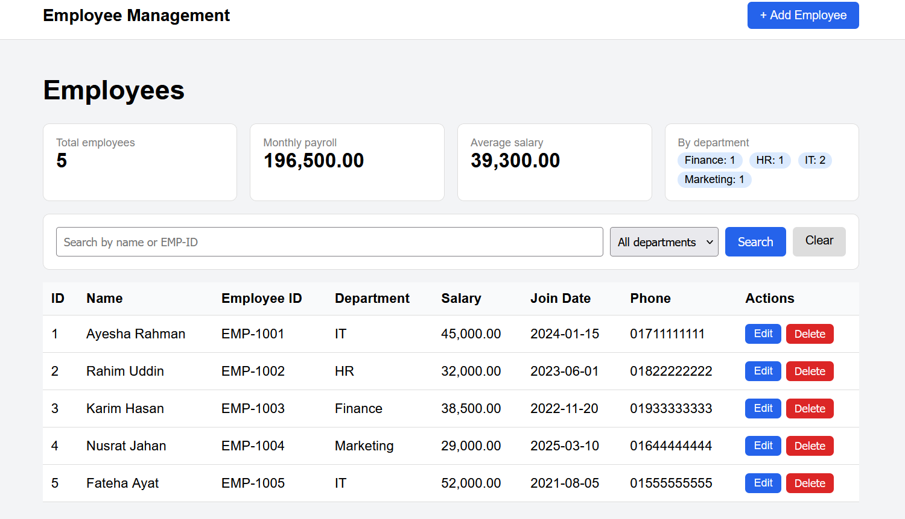
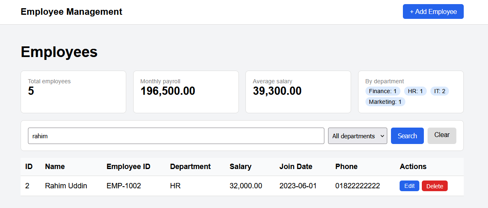
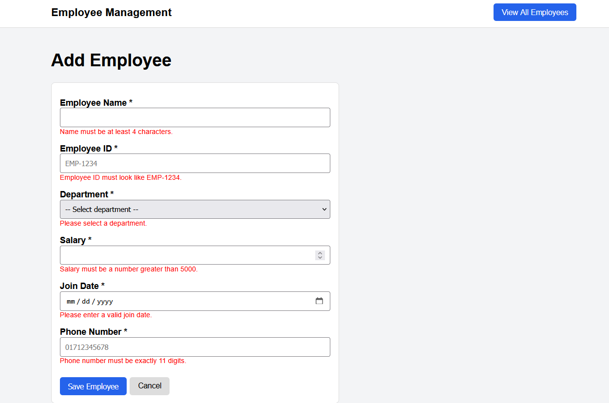
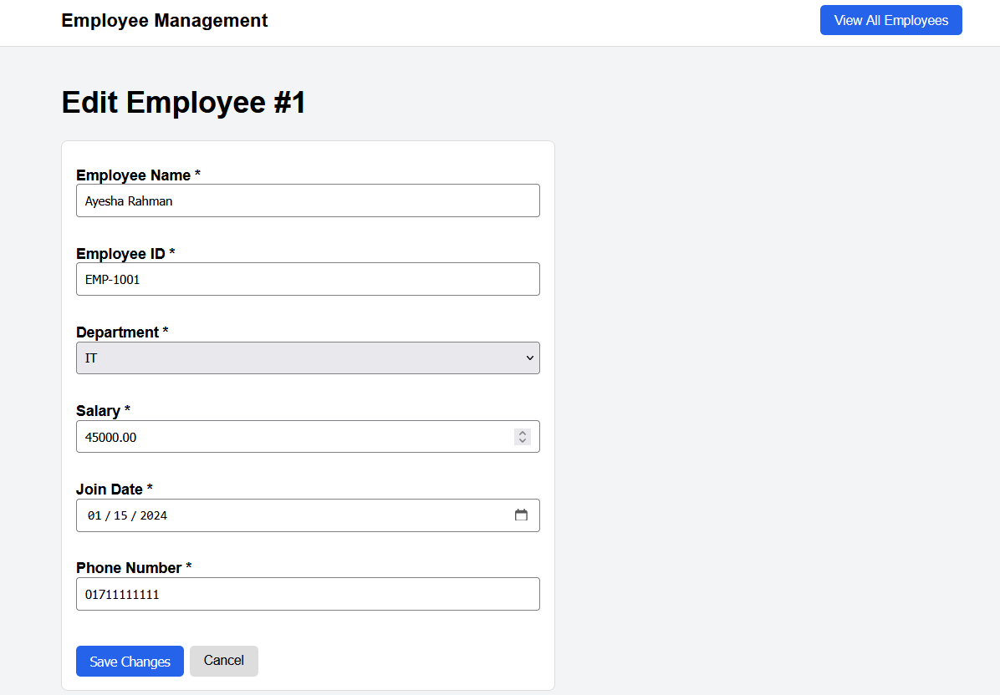

# Employee Management System

A CRUD web application for managing employee records, built with PHP, MySQL, JavaScript and CSS. It supports adding, editing and deleting employees, searching, filtering by department, and a summary of payroll figures.

## Screenshots

### Employee List
Summary cards, search bar, department filter and the employee table.



### Search and Filter
Results narrowed down by a search term.



### Add Employee Form Validation
Error messages shown when the form is submitted with invalid data.



### Edit Employee
The edit page loads the saved details of the selected employee.



## Features

- Create, view, update and delete employee records
- Search by employee name or employee ID
- Filter employees by department
- Summary cards showing total employees, monthly payroll, average salary and headcount per department
- Form validation in the browser (JavaScript) and on the server (PHP)
- Confirmation prompt before deleting a record

## Tech Stack

- PHP 8 with PDO
- MySQL
- JavaScript
- HTML and CSS

## Validation Rules

| Field | Rule |
|---|---|
| Employee Name | At least 4 characters |
| Employee ID | Format `EMP-1234`, must be unique |
| Department | HR, Finance, IT or Marketing |
| Salary | Number greater than 5000 |
| Join Date | Valid date, not in the future |
| Phone Number | Exactly 11 digits |

## Getting Started

### Requirements

- XAMPP (Apache, PHP and MySQL)

### Installation

1. Clone the repository into the `htdocs` folder of XAMPP:

```bash
   git clone https://github.com/ifatjahanlubna/employee-management.git
```

2. Start Apache and MySQL from the XAMPP control panel.

3. Open phpMyAdmin, go to the **Import** tab, select `database.sql` and click **Go**. This creates the `employee_db` database and adds a few sample employees.

4. If your MySQL root user has a password, update the connection details in `config.php`.

5. Open the app in your browser:

```
   http://localhost/employee-management/
```

## Project Structure

```
employee-management/
├── assets/
│   ├── script.js
│   └── style.css
├── includes/
│   ├── footer.php
│   ├── form.php
│   └── header.php
├── screenshots/
├── config.php
├── create.php
├── database.sql
├── delete.php
├── edit.php
├── functions.php
└── index.php
```

## Security

- All database queries use PDO prepared statements to prevent SQL injection
- Output is escaped with `htmlspecialchars()` to prevent XSS

## Author

**Ifat Jahan Lubna**
Software Engineering Student, Noakhali Science and Technology University